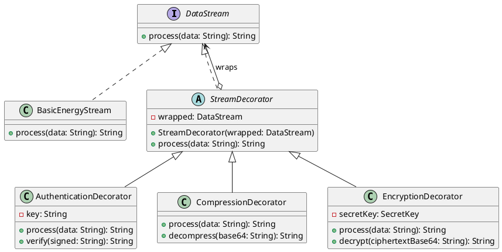
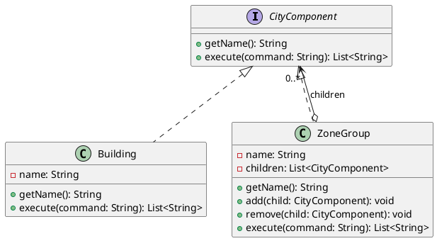
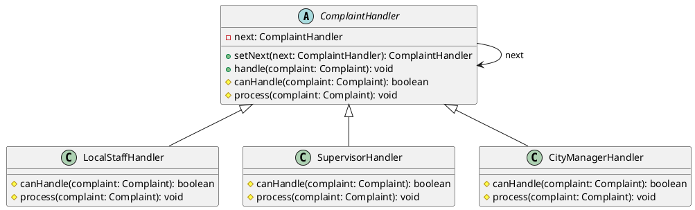
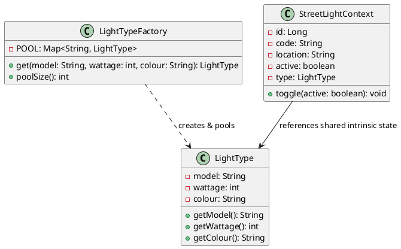
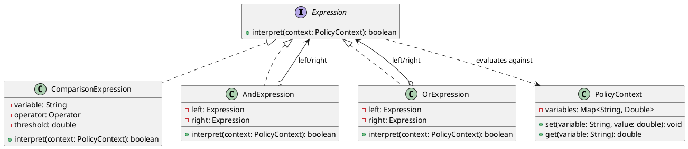

# SMARTCITY360 – SMART CITY MANAGEMENT PLATFORM
## Project Documentation & Architectural Report
**Unit Name:** Object Oriented Design Patterns II  
**Unit Code:** JIAT/OODP II  
**Assessment ID:** JIAT/OODP II/EX/01  
**Target Scenario:** UrbanTech Solutions – Smart City Management System  
**Institution:** Java Institute for Advanced Technology – Department of Examinations  
**Technology Stack:** Java 17 · Jakarta EE 10 (EJB 4.0, JPA 3.1, JSF 4.0, CDI 4.0, Bean Validation 3.0) · Payara Server 6 · MySQL 8.0 · Maven 3.9  

---

## Table of Contents
1. [Executive Summary & System Overview](#1-executive-summary--system-overview)
2. [Technology Stack & Multi-Tier Enterprise Architecture](#2-technology-stack--multi-tier-enterprise-architecture)
3. [Enterprise Security & Role-Based Access Control (RBAC)](#3-enterprise-security--role-based-access-control-rbac)
4. [Part A: Dynamic Security Wrappers for Data Streams (Decorator Pattern)](#4-part-a-dynamic-security-wrappers-for-data-streams-decorator-pattern)
5. [Part B: Hierarchical Structure of Smart Zones (Composite Pattern)](#5-part-b-hierarchical-structure-of-smart-zones-composite-pattern)
6. [Part C: Escalation of Citizen Complaints (Chain of Responsibility Pattern)](#6-part-c-escalation-of-citizen-complaints-chain-of-responsibility-pattern)
7. [Part D: Efficient Management of Smart Street Lights (Flyweight Pattern)](#7-part-d-efficient-management-of-smart-street-lights-flyweight-pattern)
8. [Part E: Interpreting City Policies Defined in DSL (Interpreter Pattern)](#8-part-e-interpreting-city-policies-defined-in-dsl-interpreter-pattern)
9. [Part F: System Data Model, Testing, Deployment & VIVA Guide](#9-part-f-system-data-model-testing-deployment--viva-guide)
   - [9.1 Relational Data Model & JPA Entity Mapping](#91-relational-data-model--jpa-entity-mapping)
   - [9.2 Verification & Comprehensive Test Plan](#92-verification--comprehensive-test-plan)
   - [9.3 VIVA Demonstration Guide (10–15 Minute Structure)](#93-viva-demonstration-guide-1015-minute-structure)
   - [9.4 Local Deployment & Execution Instructions](#94-local-deployment--execution-instructions)
10. [Appendix: PlantUML Class Diagram Sources](#10-appendix-plantuml-class-diagram-sources)

---

## 1. Executive Summary & System Overview

**SmartCity360** is a unified municipal management platform engineered for **UrbanTech Solutions**. Modern smart cities depend on heterogeneous cyber-physical systems ranging from power grid IoT sensors and smart lighting to citizen grievance desks and regulatory enforcement rules. Coordinating these interdependent services demands high modularity, rigorous decoupling, strict data integrity, and strict access governance.

This implementation provides an enterprise-ready, multi-tier Java solution that addresses all five architectural challenges defined in the assessment syllabus through the exact application of classic **Gang of Four (GoF) design patterns**:
1. **Dynamic Security for Energy Streams**: Implemented via the **Decorator Pattern**, enabling layered HMAC authentication, GZIP compression, and AES-256-GCM encryption on energy telemetry without mutating meter core components.
2. **Hierarchical Spatial Governance**: Implemented via the **Composite Pattern**, organizing the municipal topology (`City → District → Street → Building`) into a tree where operational commands are dispatched uniformly across individual structures and regional clusters.
3. **Automated Incident Escalation**: Implemented via the **Chain of Responsibility Pattern**, automatically routing citizen complaints through a decoupled triage pipeline (`LocalStaffHandler → SupervisorHandler → CityManagerHandler`) based on validated severity ratings.
4. **Memory-Scalable Streetlight Infrastructure**: Implemented via the **Flyweight Pattern**, drastically conserving JVM heap memory across tens of thousands of streetlight endpoints by caching immutable intrinsic properties (`model`, `wattage`, `colour`) in a centralized factory while isolating extrinsic mutable runtime state (`location`, `active`).
5. **Municipal Policy Automation**: Implemented via the **Interpreter Pattern**, enabling city operators to define and dynamically evaluate environmental and zoning bylaws expressed in a custom Domain-Specific Language (DSL), parsed into an Abstract Syntax Tree (AST).

To ensure defense-in-depth, the solution incorporates an enterprise security architecture utilizing salted **PBKDF2 password hashing**, a centralized **Jakarta Servlet Filter** (`AuthFilter`) enforcing **Role-Based Access Control (RBAC)** across three distinct administrative roles (`CITIZEN`, `OFFICER`, `ADMIN`), and proactive privilege escalation mitigation at self-registration.

---

## 2. Technology Stack & Multi-Tier Enterprise Architecture

The solution adheres strictly to standard Jakarta EE enterprise multi-tier architecture, completely decoupling the presentation, business logic, persistence, and enterprise security concerns.

```
smartcity360/
├── pom.xml                        # Root Parent POM (Dependency management & versions)
├── smartcity-ejb/                 # EJB 4.0 & JPA 3.1 Module
│   ├── src/main/java/lk/smartcity360/
│   │   ├── entity/                # JPA Domain Entities (User, Zone, Complaint, Streetlight, EnergyReading, CityPolicy)
│   │   ├── pattern/
│   │   │   ├── decorator/         # Part A: DataStream, StreamDecorator, Authentication, Compression, Encryption
│   │   │   ├── composite/         # Part B: CityComponent, ZoneGroup, Building, ZoneTreeBuilder
│   │   │   ├── chain/             # Part C: ComplaintHandler, LocalStaff, Supervisor, CityManager
│   │   │   ├── flyweight/         # Part D: LightType, LightTypeFactory, StreetLightContext
│   │   │   └── interpreter/       # Part E: Expression, Comparison, And, Or, PolicyParser, PolicyContext
│   │   ├── security/              # Cryptographic PBKDF2 PasswordHasher
│   │   └── service/               # Stateless EJB Session Beans (UserService, CityService, ComplaintService, etc.)
│   └── src/test/java/             # Automated JUnit 5 Unit Tests (47 test cases covering all patterns & security)
├── smartcity-web/                 # JSF 4.0 / Jakarta Faces Web Module (WAR)
│   ├── src/main/java/lk/smartcity360/web/
│   │   ├── AuthBean.java          # CDI SessionScoped backing bean managing session and authentication
│   │   ├── AuthFilter.java        # Jakarta Servlet Filter enforcing RBAC and route protection
│   │   └── *Bean.java             # CDI Backing Beans connecting JSF views to EJB services
│   └── src/main/webapp/           # XHTML/HTML Facelets views (dashboard, zones, complaints, streetlights, energy, policies)
│       └── WEB-INF/
│           ├── templates/layout.html # Master Facelets template with dynamic role-aware navigation
│           └── web.xml            # Servlet deployment descriptor, filter mappings, error page bindings
└── smartcity-ear/                 # Enterprise Application Archive (SmartCity360.ear) packaging EJB + WAR for Payara 6
```

### Architectural Layer Responsibilities
- **Presentation Tier (JSF 4.0 / CDI 4.0)**: Jakarta Faces with Facelets templating ensures a clean, DRY UI. Backing beans manage UI state, validation feedback via `FacesMessage`, and asynchronous AJAX updates. Navigation menus and interactive controls dynamically adjust visibility according to the signed-in user's role.
- **Security Interception Tier (`AuthFilter`)**: Centralized HTTP request filtering intercepting all incoming traffic (`/*`). Blocks unauthenticated visitors from accessing internal city modules, prevents privilege escalation, and verifies user roles before allowing access to administrative dashboards.
- **Business Logic Tier (EJB 4.0)**: Stateless Session Beans (`@Stateless`) execute business transactions with automatic container-managed transactions (CMT), dependency injection (`@EJB`), and isolation of GoF design pattern logic.
- **Persistence Tier (JPA 3.1 / EclipseLink)**: Maps object-oriented domain models to relational tables (`smartcity360` MySQL schema) through a JTA-managed container datasource (`jdbc/SmartCityDS`), safeguarding relational integrity with explicit foreign key and check constraints.

---

## 3. Enterprise Security & Role-Based Access Control (RBAC)

### 3.1 Privilege Escalation Vulnerability Remediation
In early baseline revisions, `signup.html` exposed an HTML `<h:selectOneMenu>` dropdown permitting self-registering users to select their assigned role from `CITIZEN`, `OFFICER`, or `ADMIN`. This constituted a critical **privilege escalation vulnerability**, enabling malicious actors to grant themselves administrative authority over city infrastructure.

**Remediation Applied Across Tiers:**
1. **Presentation Layer (`signup.html`)**: The interactive role dropdown was removed and replaced with a static informational badge confirming that public registrations are strictly assigned the **Citizen / Resident** role.
2. **Controller Layer (`AuthBean.java`)**: The `signUp()` action method discards any externally provided role parameters and explicitly invokes `userService.registerCitizen(...)`. In addition, `getRegRole()` and `setRegRole()` are locked to `"CITIZEN"`.
3. **Business Logic Layer (`UserService.java`)**: The service enforces strict role sanitization. Unrecognized, blank, or unauthorized role assignments default safely to `"CITIZEN"`. Administrative (`ADMIN`) and Operations Officer (`OFFICER`) accounts can only be provisioned internally through database seeding or authorized administrator consoles.

### 3.2 Cryptographic Authentication (`PasswordHasher.java`)
User credentials are protected using salted PBKDF2 hashing:
- **Algorithm**: `PBKDF2WithHmacSHA256`
- **Work Factor**: 10,000 iterations, 256-bit key length
- **Salt Generation**: 128-bit (16-byte) cryptographically secure random salt generated via `java.security.SecureRandom`, stored as a 32-character hexadecimal string.
- **Verification**: Evaluated using constant-time comparison (`constantTimeEquals`) to prevent timing side-channel attacks.

### 3.3 Servlet Filter Enforcement (`AuthFilter.java`)
A custom Jakarta Servlet Filter (`AuthFilter`) is registered on `/*` in `web.xml`:
- **Public Endpoints**: `/signin.html`, `/signup.html`, `/access-denied.html`, and static web resources (`/resources/*`, `/jakarta.faces.resource/*`) bypass the filter.
- **Authentication Check**: Any unauthenticated request attempting to reach protected modules (`/dashboard.html`, `/complaints.html`, `/zones.html`, `/energy.html`, `/streetlights.html`, `/policies.html`) is automatically redirected to `/signin.html`. Both full browser HTTP GET/POST and JSF partial/AJAX requests are handled seamlessly.
- **Role-Based Authorization Matrix**:

| Endpoint | Resource Description | `CITIZEN` | `OFFICER` | `ADMIN` | Unauthorized Response |
|:---|:---|:---:|:---:|:---:|:---|
| `/signin.html`, `/signup.html` | Public Authentication & Registration | Allowed | Allowed | Allowed | N/A |
| `/dashboard.html` | Operations & Overview Dashboard | Allowed | Allowed | Allowed | Redirect to `/signin.html` |
| `/complaints.html` | Incident Reporting & Resolution | Submit & View (Read-Only Status Tracking) | Submit & Resolve | Full Control | Redirect to `/signin.html` |
| `/zones.html` | Spatial Zone Topology & Broadcast | **DENIED** | Allowed | Allowed | **HTTP 403 Forbidden** (`access-denied.html`) |
| `/energy.html` | Smart Meter Ingestion & Decorator Protection | **DENIED** | Allowed | Allowed | **HTTP 403 Forbidden** (`access-denied.html`) |
| `/streetlights.html` | Flyweight Streetlight Configuration | **DENIED** | Allowed | Allowed | **HTTP 403 Forbidden** (`access-denied.html`) |
| `/policies.html` | Policy DSL Management & Interpreter Testing | **DENIED** | Allowed | Allowed | **HTTP 403 Forbidden** (`access-denied.html`) |

#### Defense-in-Depth for Incident Resolution (`complaints.html`)
To prevent unauthorized resolution of grievances by public users:
1. **Presentation Tier Isolation**: In `complaints.html`, the `ACTION` header and corresponding `<h:commandButton value="Resolve">` are wrapped in `<ui:fragment rendered="#{authBean.staffOrAdmin}">`. When a user with the `CITIZEN` role views the table, the action column is completely omitted, presenting a clean read-only status tracking log. Additionally, the resident name input is automatically pre-filled from `authBean.currentUser.fullName`.
2. **Controller Tier Enforcement**: In `ComplaintBean.resolve(Long id)`, server-side authorization validates that the active session holds `isStaffOrAdmin()`. If an unprivileged user crafts or forges a direct POST/AJAX resolution invocation, the request is immediately rejected with an error message (*"Unauthorized: Only municipal staff and administrators can resolve complaints."*) and no state change occurs in persistence.

---

## 4. Part A: Dynamic Security Wrappers for Data Streams (Decorator Pattern)

### 4.1 Design Pattern Identification and Justification (3 Marks)
**Selected Pattern: Decorator (Structural Pattern).**  
SmartCity360 ingests continuous telemetry streams from thousands of smart electricity and water meters deployed across urban zones. To prevent tampering and guarantee confidentiality across public networks, energy payloads require dynamic security services—specifically cryptographic authentication (HMAC-SHA256 signature), bandwidth optimization (GZIP compression), and payload encryption (AES-256-GCM).

**Justification:**
- **Dynamic Runtime Composition**: Unlike class-level static inheritance, which creates an explosive combination of rigid subclasses (e.g., `CompressedEncryptedStream`, `SignedCompressedStream`), the Decorator pattern attaches responsibilities dynamically at runtime by wrapping instances inside decorator objects sharing the same interface.
- **Single Responsibility Principle (SRP)**: Each transformation concern (signing, compressing, encrypting) is encapsulated in its own isolated class rather than bloating the basic stream implementation.
- **Open/Closed Principle (OCP)**: New transformation stages (e.g., streaming differential hashing, noise obfuscation) can be introduced without altering either the core component (`BasicEnergyStream`) or existing wrapper classes.

### 4.2 Support for Flexible and Layered Enhancements (4 Marks)
The Decorator pattern achieves layering by ensuring that both the concrete component and the abstract decorator implement the common interface `DataStream`:

```java
public interface DataStream {
    String process(String data);
}
```

The abstract `StreamDecorator` holds a reference to an inner `DataStream` component and delegates the `process` call:

```java
public abstract class StreamDecorator implements DataStream {
    protected final DataStream wrapped;
    public StreamDecorator(DataStream wrapped) { this.wrapped = wrapped; }
    @Override
    public String process(String data) { return wrapped.process(data); }
}
```

The concrete decorators implement specialized forward and reverse transformations:
1. `AuthenticationDecorator`: Appends an HMAC-SHA256 cryptographic signature (`payload#signature`) using a secret HMAC key. Provides `verify(signed)` to detect data tampering.
2. `CompressionDecorator`: Compresses the payload string using GZIP and encodes the byte array into RFC 4648 Base64. Provides `decompress(compressedBase64)` to reconstruct the original stream.
3. `EncryptionDecorator`: Encrypts the payload using AES-256-GCM with a fresh, cryptographically random 12-byte Initialization Vector (IV) per invocation. Provides `decrypt(ivCiphertextBase64)` to recover the plaintext.

**Ordering Significance**:  
The business service `EnergyService.protect()` chains these wrappers in a precise mathematical order:
$$\text{Output} = \text{Encrypt}(\text{Compress}(\text{Sign}(\text{Plaintext})))$$
Compression must strictly precede encryption because high-entropy ciphertext produced by AES-GCM is mathematically incompressible. The Decorator pattern enables this exact execution sequence:

```java
DataStream pipeline = new EncryptionDecorator(
                         new CompressionDecorator(
                             new AuthenticationDecorator(
                                 new BasicEnergyStream(), streamKey), 
                             streamKey), 
                         streamKey);
String protectedPayload = pipeline.process(rawMeterReading);
```

### 4.3 Evaluation of Long-Term Benefits: Reusability and Extensibility (8 Marks)
- **Reusability Across Domains**: Neither `CompressionDecorator` nor `EncryptionDecorator` contains business logic tied to energy metering. They operate exclusively on the `DataStream` contract. Consequently, the identical decorators can be reused across traffic camera telemetry, environmental air quality streams, or water treatment sensor logs.
- **Independent Evolution & Maintenance**: Cryptographic algorithms can be upgraded independently. For instance, transitioning from AES-GCM to post-quantum cryptographic schemes requires replacing or updating `EncryptionDecorator` alone, with zero regression risk to compression or message hashing.
- **Selective Pipeline Configuration**: In high-bandwidth private fiber municipal links, compression can be bypassed while retaining authentication and encryption simply by omitting `CompressionDecorator` from the wrapper chain.
- **Interactive Security Pipeline UI (`energy.html`)**:
  - **Dynamic Layer Configuration**: Operators can assemble any combination and order of wrappers (Layer 1 inner, Layer 2, Layer 3 outer) around real meters ingested from MySQL (e.g. `EM-1001`, `EM-1002`, `EM-1003`).
  - **Step-by-Step Sender Telemetry**: Visualizes progressive payload transformations (Core stream, Layer 1, Layer 2, Layer 3) showing exact character counts and payload previews.
  - **Network Transmission & Attack Simulation**: Features an *"An attacker changes the data"* simulation checkbox demonstrating automated detection of bit flips and malicious payload mutations in transit.
  - **Control Centre Reverse-Peel Verification**: The receiver peels layers in exact reverse sequence:
    $$\text{Decrypt}\;(\text{AES-GCM}) \longrightarrow \text{Decompress}\;(\text{GZIP}) \longrightarrow \text{Verify Signature}\;(\text{HMAC-SHA256})$$
    Each step displays live status badges (`Decrypt OK`, `Decompress OK`, `Verify signature OK`), confirming data integrity and confidentiality.
- **Trade-offs & Mitigations**:
  - *Tracing Complexity*: Multi-layer wrapper chains can complicate step-by-step debugging. *Mitigation*: Each concrete decorator includes clear log traces and paired inverse functions (`verify`, `decompress`, `decrypt`) verified by comprehensive unit tests (`DecoratorTest.java`).
  - *Key Management*: Symmetric cryptography requires secure key distribution. In SmartCity360, the key is externalized via the `SMARTCITY_STREAM_KEY` environment variable with a safe development fallback.

---

## 5. Part B: Hierarchical Structure of Smart Zones (Composite Pattern)

### 5.1 Design Pattern Identification and Justification (3 Marks)
**Selected Pattern: Composite (Structural Pattern).**  
Municipal infrastructure is inherently recursive and partitioned into geopolitical levels: a **City** contains multiple **Districts**; each District contains **Streets**; each Street contains multiple physical **Buildings**. Operators frequently need to execute administrative actions—such as `"SHUTDOWN_POWER"` or `"REPORT_USAGE"`—either on an entire city, a single district, or an isolated individual building.

**Justification:**
- **Part-Whole Hierarchy Representation**: The Composite pattern organizes objects into tree structures to represent part-whole hierarchies.
- **Uniform Client Code**: The Composite pattern allows clients to treat individual objects (`Building` leaves) and compositions of objects (`ZoneGroup` composites) uniformly through a shared contract (`CityComponent`). A client broadcasting an order does not need conditional `if (isGroup) { loop; } else { doSingle; }` branching.

### 5.2 UML Class Diagram (4 Marks)

```
        +-----------------------------------------------+
        |              <<interface>>                    |
        |              CityComponent                    |
        +-----------------------------------------------+
        | + getName() : String                          |
        | + execute(command : String) : List<String>    |
        | + getUsage() : double                         |
        | + setPower(on : boolean) : void               |
        | + isPowerOn() : boolean                       |
        +-----------------------------------------------+
                                ^
                                |
             +------------------+------------------+
             |                                     |
+--------------------------+         +-------------------------------+
|         Building         |         |           ZoneGroup           |
|         (Leaf)           |         +-------------------------------+
+--------------------------+         | - name : String               |
| - name : String          |         | - children : List<CityComponent>|
| - usage : double         |         +-------------------------------+
| - powerOn : boolean      |         | + getName() : String          |
+--------------------------+         | + add(c : CityComponent) : void|
| + getName() : String     |         | + remove(c : CityComponent): void|
| + execute(cmd) : List<Str>|        | + execute(cmd) : List<String> |
| + getUsage() : double    |         | + getUsage() : double         |
| + setPower(on) : void    |         | + setPower(on) : void         |
| + isPowerOn() : boolean  |         | + isPowerOn() : boolean       |
+--------------------------+         +-------------------------------+
                                                     o
                                                     | 0..*
                                                     +------- (aggregates children)
```

*(See Appendix for the exact PlantUML source code: `docs/uml/PartB-Composite.puml`)*

### 5.3 Infrastructure Scalability and Management (8 Marks)
- **Hierarchical Usage Aggregation**: The Composite pattern aggregates energy usage recursively at every structural level:
  $$\text{Building (Leaf)} \longrightarrow \text{Street (Composite)} \longrightarrow \text{District (Composite)} \longrightarrow \text{City (Root Composite)}$$
  In SmartCity360, each `Building` returns its individual load (e.g. `Shopping Mall` reports $450.00\text{ kWh}$, `City Hospital` reports $380.50\text{ kWh}$). When `getUsage()` is called on composite nodes, `ZoneGroup` sums its children's readings dynamically:
  - $\text{Galle Road} = 450.00 + 380.50 = 830.50\text{ kWh}$
  - $\text{Dharmapala Mawatha} = 120.00 + 95.25 = 215.25\text{ kWh}$
  - $\text{Colombo 03 - Kollupitiya} = 830.50 + 215.25 = 1045.75\text{ kWh}$
  - $\text{Colombo 07 - Cinnamon Gardens} = 150.00 + 210.00 = 360.00\text{ kWh}$
  - $\text{Colombo (Total City)} = 1045.75 + 360.00 = \mathbf{1405.75\text{ kWh}}$
- **Uniform Power Control at Any Level**: Operators can invoke `setPower(boolean)` or `"SHUTDOWN_POWER"` / `"RESTORE_POWER"` on any node in the hierarchy. The call executes identically whether targeting the entire city, a specific district, a single street, or an individual building, cascading down to all constituent nodes and updating their operational badges (`ON` / `OFF`).
- **Dynamic City Growth**: When the city expands (e.g., adding an `EV Charging Station` of $75\text{ kWh}$ under `Galle Road`), the new building is persisted into table `city_zone`, and the Composite tree is rebuilt immediately. The usage totals for `Galle Road` ($830.50 \rightarrow 905.50\text{ kWh}$), `Kollupitiya` ($1045.75 \rightarrow 1120.75\text{ kWh}$), and `Colombo` ($1405.75 \rightarrow 1480.75\text{ kWh}$) update automatically without requiring manual recalculations.
- **Interactive Collapsible Tree UI (`zones.html`)**: The presentation tier provides an interactive tree-table where:
  - Parent nodes (`City`, `District`, `Street`) display a clickable expand/collapse chevron (`▼`) and clickable parent names to toggle sub-branches on demand.
  - Quick action controls (`Expand all` / `Collapse all`) allow operators to collapse or expand the entire municipal tree in one click.
  - A dedicated **Reset the city** button allows restoring the baseline Colombo topology in MySQL (`city_zone`) for demonstration and testing.

---

## 6. Part C: Escalation of Citizen Complaints (Chain of Responsibility Pattern)

### 6.1 Design Pattern Identification and Justification (3 Marks)
**Selected Pattern: Chain of Responsibility (Behavioral Pattern).**  
Citizens submit service grievances regarding power outages, burst water mains, noise disturbances, and road damage. Different categories and urgency levels require different levels of bureaucratic authority. Minor issues should be handled immediately by local technicians, whereas critical city-wide emergencies require mayoral intervention.

**Justification:**
- **Decoupling Sender from Receivers**: The submission UI (`complaints.html`) and service (`ComplaintService`) do not need to know which specific officer level will resolve the issue. The complaint is passed into the head of the chain.
- **Dynamic Multi-Stage Processing**: Handlers are linked in sequential succession. Each handler evaluates whether its internal business threshold covers the complaint; if not, it forwards the request down the chain.

### 6.2 Decoupled Request Handling Mechanism (4 Marks)
The base class `ComplaintHandler` defines the successor link and default dispatching:

```java
public abstract class ComplaintHandler {
    private ComplaintHandler next;
    public ComplaintHandler setNext(ComplaintHandler next) {
        this.next = next;
        return next;
    }
    public void handle(Complaint complaint) {
        if (canHandle(complaint)) {
            process(complaint);
        } else if (next != null) {
            next.handle(complaint);
        } else {
            fallback(complaint);
        }
    }
    protected abstract boolean canHandle(Complaint complaint);
    protected abstract void process(Complaint complaint);
}
```

The concrete handlers are linked in sequential order during service execution:
1. `LocalStaffHandler`: Handles complaints with severity $1 \le \text{severity} \le 2$. Sets `assignedLevel = LOCAL` and `status = ASSIGNED`.
2. `SupervisorHandler`: Handles complaints with severity $3 \le \text{severity} \le 4$. Sets `assignedLevel = SUPERVISOR` and `status = ASSIGNED`.
3. `CityManagerHandler`: Handles emergency complaints with $\text{severity} \ge 5$. Sets `assignedLevel = CITY_MANAGER` and `status = ASSIGNED`.
4. **Fallback Handler**: If an invalid or unclassified severity is provided, the termination logic flags the complaint as `MANUAL_REVIEW`, guaranteeing that no request is silently dropped.

### 6.3 Evaluation of Flexibility and Traceability (8 Marks)
- **Flexibility Benefits**:
  - *Dynamic Chain Reconfiguration*: Handlers can be rearranged, inserted, or removed at runtime without breaking client code. For example, a specialized `EmergencyResponseUnitHandler` can be inserted before `CityManagerHandler` during natural disasters.
  - *Clean Code Structure*: Replaces complex, brittle `switch-case` and nested `if-else` blocks in business controllers with modular, independently testable classes.
- **Traceability Challenges & Mitigations**:
  - *Silent Execution Risk*: In poorly designed chains, if no handler processes a request, the request can drop off the end silently. *Mitigation*: SmartCity360's base handler explicitly incorporates an automated fallback handler setting `AssignmentLevel.UNASSIGNED` and `ComplaintStatus.MANUAL_REVIEW`.
  - *Audit Logging*: Every state transition is stamped with timestamps, assigned officer levels, and persisted in the MySQL database table `complaints` for accountability.

---

## 7. Part D: Efficient Management of Smart Street Lights (Flyweight Pattern)

### 7.1 Design Pattern Identification and Justification (3 Marks)
**Selected Pattern: Flyweight (Structural Pattern).**  
Smart cities deploy hundreds of thousands of connected LED streetlights across thousands of kilometers of roadways. In a naive object-oriented design, storing 100,000 distinct streetlight instances—each holding its own model name strings, wattage specifications, optic lens data, and color parameters—wastes tens of megabytes of JVM heap memory on identical duplicate strings and numbers.

**Justification:**
- **Elimination of Redundant State**: The Flyweight pattern minimizes memory usage by sharing common, immutable state among many fine-grained objects.
- **State Partitioning**: By cleanly dividing streetlight state into **intrinsic** (shared, hardware-specific) and **extrinsic** (unique, per-pole) state, the platform enables massive horizontal scalability.

### 7.2 Handling of Shared (Intrinsic) and Unique (Extrinsic) Properties (4 Marks)
SmartCity360 cleanly partitions streetlight attributes across relational storage and JVM memory:
- **Intrinsic State (`street_light_type` / `LightType.java`)**: Independent of the streetlight's physical location. It is immutable and shared across thousands of poles:
  - `model` (e.g., `"SL-LED-120"`, `"SL-LED-60"`)
  - `wattage` (e.g., `120W`, `60W`)
  - `colour` (e.g., `"Cool White"`, `"Warm White"`)
  - `dimming_profile`: 24-hour hourly dimming percentage curves (`int[24]`), defining automated power scaling from 0:00 to 23:00.
- **Extrinsic State (`street_light` / `StreetLightContext.java` / `Streetlight.java`)**: Unique to each specific deployment point. It is supplied from external context and stored individually:
  - `id` and unique asset `code` (e.g., `"GR-001"`, `"RES-00001"`)
  - Geographic `location` (e.g., GPS latitude/longitude `"6.9147, 79.8489"`)
  - Operational status `faulty` / `active` (e.g., defective fixture flag)
  - Foreign key reference (`type_id`) pointing to the shared `street_light_type` record and flyweight object.

**Factory Caching Mechanism (`LightTypeFactory.java`)**:  
A thread-safe factory maintains a pool of unique `LightType` instances backed by a `ConcurrentHashMap`:

```java
public class LightTypeFactory {
    private static final Map<String, LightType> POOL = new ConcurrentHashMap<>();

    public static LightType get(String model, int wattage, String colour) {
        String key = (model + ":" + wattage + ":" + colour).toLowerCase();
        return POOL.computeIfAbsent(key, k -> new LightType(model, wattage, colour));
    }
    public static int poolSize() { return POOL.size(); }
}
```

### 7.3 Performance Impact and Scalability Analysis (8 Marks)
- **Heap Memory Optimization & Dimming Curve Savings**:  
  Consider an urban deployment of $N = 10,004$ streetlights (or up to $100,000$ in load simulations) across Colombo, configured from two standardized municipal fixture types (`SL-LED-120` and `SL-LED-60`):
  - *Without Flyweight*: Storing an independent 24-slot integer array per luminaire consumes $10,004 \times 24 = 240,096\text{ ints}$ ($\mathbf{937.9\text{ KB}}$) on redundant dimming schedules alone.
  - *With Flyweight*: The 24-hour dimming profile is stored once per shared configuration in the Flyweight pool, requiring only $2 \times 24 = 48\text{ ints}$ ($\mathbf{192\text{ bytes}}$).
  - *Net Heap Reduction*: Over **99.98% memory savings** on dimming schedules, with negligible allocation latency ($\sim 43\text{ ms}$ for over 10,000 nodes).
- **Garbage Collection (GC) Pressure Reduction**: Massively reducing temporary object churn during bulk synchronization reduces GC pause times on the Payara application server.
- **Thread Safety**: Because `LightType` instances are immutable and the pool uses `ConcurrentHashMap.computeIfAbsent()`, concurrent HTTP worker threads can query and register lights without thread-lock contention.
- **Live MySQL Synchronization & Scale Simulation (`streetlights.html`)**:
  - **Live MySQL Loading**: Ingests all records from `street_light` joined with `street_light_type`, resolving intrinsic profiles into shared memory instances.
  - **In-Memory Scale Simulation**: Allows simulating up to 100,000 luminaires on-the-fly with adjustable highway/arterial ratios, defective fixture counts, and evaluation hours without polluting database tables.
  - **Inspection Views**: Visualizes shared configuration instances with their memory object hashes (`#9c8df1`, `#44f14353`), aggregate fixture usage counts, and operational status badges (`OK` / `FAULTY`).

---

## 8. Part E: Interpreting City Policies Defined in DSL (Interpreter Pattern)

### 8.1 Design Pattern Identification and Justification (3 Marks)
**Selected Pattern: Interpreter (Behavioral Pattern).**  
City administrators frequently update operational ordinances and environmental bylaws (e.g., adjusting night-time residential noise limits, congestion charges during peak traffic hours, or dimming streetlights past midnight). Hardcoding these business rules into Java source code requires continuous recompilation, redeployment, and testing cycles.

**Justification:**
- **Dynamic Rule Definition**: The Interpreter pattern defines a grammatical representation for a Domain-Specific Language (DSL) alongside an interpreter that evaluates rule expressions against runtime context objects.
- **Runtime Flexibility**: City council ordinances can be stored as plain-text database records and interpreted on-the-fly without restarting the enterprise application.

### 8.2 UML Class Diagram (4 Marks)

```
                       +---------------------------------------+
                       |             <<interface>>             |
                       |              Expression               |
                       +---------------------------------------+
                       | + interpret(ctx: PolicyContext): bool |
                       +---------------------------------------+
                                           ^
                                           |
            +------------------------------+-------------------------------+
            |                                                              |
+-----------------------------------+                     +---------------------------------+
|       ComparisonExpression        |                     |          AndExpression          |
+-----------------------------------+                     +---------------------------------+
| - variable : String               |                     | - left  : Expression            |
| - operator : Operator             |                     | - right : Expression            |
| - threshold: double               |                     +---------------------------------+
+-----------------------------------+                     | + interpret(ctx) : boolean      |
| + interpret(ctx) : boolean        |                     +---------------------------------+
+-----------------------------------+                                      |
                                                                           o (combines two)
                                                                      left, right
```

*(See Appendix for the exact PlantUML source code: `docs/uml/PartE-Interpreter.puml`)*

### 8.3 Grammatical Rules, Extensibility, and Assessment (8 Marks)
The system defines an unambiguous Backus-Naur Form (BNF) grammar supporting boolean logic, precedence, parentheses, and negation:

$$\begin{aligned}
\text{policy} &\Coloneqq \text{disjunction} \\
\text{disjunction} &\Coloneqq \text{conjunction}\; (\text{"OR"}\;\text{conjunction})^* \\
\text{conjunction} &\Coloneqq \text{unary}\; (\text{"AND"}\;\text{unary})^* \\
\text{unary} &\Coloneqq \text{"NOT"}\;\text{primary} \mid \text{primary} \\
\text{primary} &\Coloneqq \text{"("}\;\text{policy}\;\text{")"} \mid \text{comparison} \\
\text{comparison} &\Coloneqq \text{identifier}\;\; \text{operator}\;\; \text{number} \\
\text{operator} &\Coloneqq \text{">"} \mid \text{">="} \mid \text{"<"} \mid \text{"<="} \mid \text{"=="} \mid \text{"!="}
\end{aligned}$$

- **Abstract Syntax Tree (AST) Parsing (`PolicyParser.java`)**:  
  `PolicyParser` compiles expressions into an Abstract Syntax Tree where parentheses alter precedence, `NOT` inverts sub-expressions, and `AND` binds tighter than `OR`. For example, the municipal noise ordinance:
  $$(hour \ge 22 \;\text{OR}\; hour < 6) \;\text{AND}\; noise \le 50 \;\text{OR}\; (hour \ge 6 \;\text{AND}\; hour < 22) \;\text{AND}\; noise \le 70$$
  is parsed into a balanced tree of `OrExpression`, `AndExpression`, and `ComparisonExpression` nodes.
- **Evaluation Mechanism (`PolicyContext.java`)**:  
  `PolicyContext` holds sensor measurements (e.g., `hour = 23.0`, `noise = 65.0`). When `interpret(context)` is called, the AST evaluates recursively to return `true` (compliant) or `false` (violation flagged). Undefined sensor variables immediately throw a descriptive `IllegalArgumentException`, preventing silent evaluations.
- **Zero-Downtime Rule Hot-Patching (`policies.html`)**:
  - **Dynamic Rule Updates**: City officials can modify active ordinances via the **Update a rule (no restart)** interface. The updated expression is compiled into a new AST and persisted into MySQL table `city_policies`.
  - **Immutable Audit Logging (`policy_history`)**: Every rule alteration is immutably timestamped and recorded in table `policy_history` (`CHANGED`, `POLICY`, `OLD RULE`, `NEW RULE`) for regulatory traceability.
  - **Real-Time Event Verification**: The **Check an event** panel evaluates real-time sensor telemetry strings (e.g., `hour=23, noise=65`) against any active ordinance with instant visual pass/fail badges.
  - **Ad-Hoc Rule Sandbox**: The **Try your own rule** tool compiles and evaluates arbitrary custom DSL expressions and telemetry pairs on-the-fly.
  - **Reset to Baseline**: The **Reset the rules** action re-seeds the standard municipal ordinances catalog.
- **Extensibility Evaluation**:
  - *Adding Operators*: Adding arithmetic, range checks (`BETWEEN`), or regular expression operators simply requires adding corresponding `Expression` implementations.
  - *Maintainability*: Rules are validated prior to saving in `PolicyService.save()`; invalid expressions (e.g., mismatched tokens or unknown operators) are rejected at the persistence boundary.

---

## 9. Part F: System Data Model, Testing, Deployment & VIVA Guide

### 9.1 Relational Data Model & JPA Entity Mapping
The physical relational schema is implemented in `database/smartcity360.sql`:

```sql
CREATE TABLE app_users (
    id            BIGINT AUTO_INCREMENT PRIMARY KEY,
    username      VARCHAR(60)  NOT NULL UNIQUE,
    email         VARCHAR(120) NOT NULL UNIQUE,
    full_name     VARCHAR(120) NOT NULL,
    password_hash VARCHAR(128) NOT NULL,
    salt          VARCHAR(64)  NOT NULL,
    role          VARCHAR(30)  NOT NULL DEFAULT 'CITIZEN',
    created_at    DATETIME     NOT NULL,
    INDEX idx_users_username (username),
    INDEX idx_users_email (email)
);

CREATE TABLE city_zone (
    id         BIGINT AUTO_INCREMENT PRIMARY KEY,
    name       VARCHAR(150) NOT NULL,
    type       VARCHAR(30)  NOT NULL,
    parent_id  BIGINT       NULL,
    usage_kwh  DOUBLE       NOT NULL DEFAULT 0.0,
    power_on   BOOLEAN      NOT NULL DEFAULT TRUE,
    CONSTRAINT fk_city_zone_parent FOREIGN KEY (parent_id) REFERENCES city_zone (id),
    CONSTRAINT ck_city_zone_type CHECK (type IN ('CITY', 'DISTRICT', 'STREET', 'BUILDING'))
);

-- Backwards compatibility view
CREATE OR REPLACE VIEW zones AS SELECT * FROM city_zone;

CREATE TABLE complaints (
    id             BIGINT AUTO_INCREMENT PRIMARY KEY,
    resident_name  VARCHAR(150)  NOT NULL,
    description    VARCHAR(1000) NOT NULL,
    severity       INT           NOT NULL,
    status         VARCHAR(30)   NOT NULL,
    assigned_level VARCHAR(30)   NOT NULL,
    created_at     DATETIME      NOT NULL,
    CONSTRAINT ck_complaints_severity CHECK (severity BETWEEN 1 AND 5),
    INDEX idx_complaints_status (status)
);

CREATE TABLE street_light_type (
    id              BIGINT AUTO_INCREMENT PRIMARY KEY,
    code            VARCHAR(80)  NOT NULL UNIQUE,
    model           VARCHAR(100) NOT NULL,
    wattage         INT          NOT NULL,
    colour          VARCHAR(30)  NOT NULL,
    dimming_profile VARCHAR(255) NOT NULL
);

CREATE TABLE street_light (
    id       BIGINT AUTO_INCREMENT PRIMARY KEY,
    code     VARCHAR(80)  NOT NULL UNIQUE,
    location VARCHAR(200) NOT NULL,
    type_id  BIGINT       NOT NULL,
    faulty   BOOLEAN      NOT NULL DEFAULT FALSE,
    CONSTRAINT fk_street_light_type FOREIGN KEY (type_id) REFERENCES street_light_type (id)
);

-- Backwards compatibility view for legacy streetlights
CREATE OR REPLACE VIEW streetlights AS
SELECT sl.id, sl.code, sl.location, slt.model, slt.wattage, slt.colour, NOT sl.faulty AS active
FROM street_light sl
JOIN street_light_type slt ON sl.type_id = slt.id;

CREATE TABLE energy_readings (
    id             BIGINT AUTO_INCREMENT PRIMARY KEY,
    meter_code     VARCHAR(80) NOT NULL,
    kilowatt_hours DOUBLE      NOT NULL,
    recorded_at    DATETIME    NOT NULL,
    INDEX idx_energy_recorded (recorded_at)
);

CREATE TABLE city_policies (
    id         BIGINT AUTO_INCREMENT PRIMARY KEY,
    name       VARCHAR(150)  NOT NULL,
    expression VARCHAR(1000) NOT NULL,
    enabled    BOOLEAN       NOT NULL DEFAULT TRUE
);

CREATE TABLE policy_history (
    id          BIGINT AUTO_INCREMENT PRIMARY KEY,
    policy_name VARCHAR(150)  NOT NULL,
    old_rule    VARCHAR(1000) NOT NULL,
    new_rule    VARCHAR(1000) NOT NULL,
    changed_at  DATETIME      NOT NULL
);
```

---

### 9.2 Verification & Comprehensive Test Plan

#### Automated JUnit 5 Unit Tests (47 Passing Tests)
Executed via `mvn test` without requiring a live database or application server:
1. **`DecoratorTest` (6 tests)**: Validates full cryptographic round-trip (encryption $\rightarrow$ compression $\rightarrow$ signature verification), tamper detection, wrong-key failure, and raw fallback stream.
2. **`CompositeTest` (8 tests)**: Validates leaf and group execution, recursive hierarchy traversal, multi-level broadcast propagation, empty composite safety, power state cascading (`setPower`), and hierarchical energy usage aggregation across nodes.
3. **`ChainTest` (6 tests)**: Tests exact severity threshold boundaries: severity 1–2 routed to Local Staff; severity 3–4 routed to Supervisor; severity 5 routed to City Manager; unhandled/boundary values routed to manual review.
4. **`FlyweightTest` (4 tests)**: Verifies that identical light fixtures return identical shared flyweight instances from the factory cache, while distinct configurations allocate distinct flyweights; validates 24-hour dimming profiles, hex identity hashes, and faulty light behavior.
5. **`InterpreterTest` (17 tests)**: Validates comparison operators (`>`, `>=`, `<`, `<=`, `==`, `!=`), precedence of `AND` over `OR`, parentheses `( )`, logical negation (`NOT`), Abstract Syntax Tree (AST) serialization, case-insensitivity, syntax error handling, and rejection of undefined variables.
6. **`PasswordHasherTest` (4 tests)**: Validates PBKDF2 salt generation, hash reproducibility, rejection of incorrect passwords, unique salts generating distinct hashes for identical passwords, and matches against seeded database test hashes.
7. **`UserEntityTest` (2 tests)**: Validates that new `User` entities default strictly to the `CITIZEN` role.

#### Manual Verification Script on Live Deployment

```
+----+------------------------------------------------+-------------------------------------------------------------+------------------------------------+
| #  | Test Case Description                          | Procedure / Input                                           | Expected Outcome                   |
+----+------------------------------------------------+-------------------------------------------------------------+------------------------------------+
| 1  | Unauthenticated URL Interception               | Open http://localhost:8080/smartcity360/dashboard.html     | Redirected to /signin.html         |
| 2  | Privilege Escalation Prevention                | Open /signup.html; fill form; submit                        | Role locked to CITIZEN; registered |
| 3  | Role Authorization - Citizen Access Rejection  | Log in as 'citizen'; open /zones.html directly in address   | HTTP 403 Forbidden; access-denied  |
| 4  | Role Authorization - Officer/Admin Module View | Log in as 'officer' or 'admin'; check navigation sidebar    | All 5 pattern modules displayed    |
| 5  | Composite Spatial Broadcast                    | In City Zones, send 'INSPECT' to Metro City (ID: 1)         | Every child zone/building logs cmd |
| 6  | Complaint Escalation Routing                   | Submit complaints with severity 1, 3, and 5                 | Assigned to LOCAL, SUP, MANAGER    |
| 7  | Flyweight Pool Verification                    | Register 3 streetlights with identical model/wattage/colour | Flyweight pool size increases by 1 |
| 8  | Decorator Energy Protection                    | Click 'Protect sample' in Energy module                     | Base64 encrypted ciphertext output |
| 9  | Policy DSL Evaluation                          | Test 'noiseDb > 60 AND hour >= 22' with noiseDb=65, hour=23 | Evaluates to TRUE                  |
+----+------------------------------------------------+-------------------------------------------------------------+------------------------------------+
```

---

### 9.3 VIVA Demonstration Guide (10–15 Minute Structure)

When demonstrating SmartCity360 during the VIVA examination, follow this structured time-allocated itinerary:

```
[0:00 - 1:30] Introduction & Architecture Overview
  * State unit details: JIAT/OODP II, UrbanTech Solutions scenario.
  * Explain EAR multi-tier layout: EJB 4.0 business tier, JSF 4.0 presentation tier, JPA persistence tier.
  * Highlight clean separation of concerns and automated JUnit 5 test suite (47 passing tests).

[1:30 - 3:00] Enterprise Security & RBAC Demonstration
  * Show pre-configured test users: admin/admin123, officer/officer123, citizen/citizen123.
  * Demonstrate privilege escalation remediation on /signup.html (locked to CITIZEN; no dropdown).
  * Sign in as 'citizen' and attempt direct access to /zones.html: show HTTP 403 Forbidden on access-denied.html.
  * Show how layout.html adapts sidebar navigation dynamically based on user role.

[3:00 - 5:00] Part B: Hierarchical Smart Zones (Composite Pattern)
  * Explain the component hierarchy: CityComponent interface, ZoneGroup composite, Building leaf.
  * Demonstrate interactive collapsible tree in /zones.html: expand/collapse sub-branches with chevrons.
  * Show aggregated energy usage at every level: Building -> Street -> District -> City (Colombo = 1405.75 kWh).
  * Demonstrate power switching: 'Shutdown power' and 'Restore power' cascading to child nodes with ON/OFF badges.
  * Demonstrate dynamic city growth: add building 'EV Charging Station' (75 kWh) under 'Galle Road', show live tree rebuild and updated usage totals from MySQL table city_zone.
  * Demonstrate 'Reset the city' button restoring baseline Colombo topology.

[5:00 - 7:00] Part C: Citizen Complaint Escalation (Chain of Responsibility)
  * Show ComplaintHandler base class and successor chaining.
  * Sign in as 'citizen': resident name is auto-populated in grievance form; note that 'Resolve' button is hidden.
  * Submit three test grievances:
      - Severity 1 (flickering lamp) -> Assigned to LOCAL staff.
      - Severity 3 (pothole cluster) -> Assigned to SUPERVISOR.
      - Severity 5 (main water burst) -> Escalated immediately to CITY_MANAGER.
  * Sign in as 'officer' or 'admin': resolve a complaint, demonstrating defense-in-depth authorization and dynamic reduction in pending complaints.

[7:00 - 9:00] Part D: Smart Streetlights (Flyweight Pattern)
  * Explain the memory bottleneck: tens of thousands of streetlights sharing identical physical properties.
  * Differentiate Intrinsic (street_light_type: model, wattage, colour, 24-hr dimming profile) vs. Extrinsic (street_light: location, faulty status).
  * Demonstrate in UI: load 10,004 lights from MySQL, or simulate 100,000 luminaires in-memory.
  * Show memory benchmark cards: 240,096 ints (937.9 KB) without flyweight vs. 48 ints (192 bytes) with flyweight (99.98% memory savings).
  * Show shared object identity hash codes and individual pole inspection with OK/FAULTY badges.

[9:00 - 11:00] Part E: City Policy Mini-Language (Interpreter Pattern)
  * Show BNF grammar: comparison operators (>, >=, <, <=, ==, !=), logical keywords (AND, OR, NOT), parentheses ( ).
  * Demonstrate AST parsing: 'The city's rules' displaying compiled expression tree representation.
  * Test live in UI: evaluate telemetry variables (e.g. 'hour=23, noise=65') against active policies.
  * Demonstrate live zero-downtime hot-patching: update a rule in MySQL without restarting Payara; view update logged to policy_history.
  * Demonstrate 'Try your own rule' sandbox evaluating custom expressions and sensor telemetry streams.

[11:00 - 12:30] Part A: Dynamic Security Wrappers (Decorator Pattern)
  * Explain the 3-tier selectable pipeline: Authentication, Compression, Encryption.
  * Discuss why ordering matters: compressed ciphertext is incompressible; HMAC verifies integrity.
  * Demonstrate in UI: select meter and layers, click 'Send the data'.
  * Show sender step-by-step layer encapsulation preview and character size changes.
  * Demonstrate reverse-peel verification at the control centre: Decrypt OK -> Decompress OK -> Verify signature OK.
  * Check 'An attacker changes the data' and demonstrate real-time tampering detection and signature verification failure.

[12:30 - 15:00] Code Review, UML Inspection & Conclusion
  * Open docs/uml diagrams and show alignment with working packages.
  * Summarize maintainability, extensibility, and memory benefits achieved through GoF patterns.
  * Answer examiner questions.
```

---

### 9.4 Local Deployment & Execution Instructions

1. **Start Database**:
   ```bash
   docker compose up -d
   ```
   *(Or execute `database/smartcity360.sql` in local MySQL 8. Default credentials: `smartcity` / `smartcity`).*

2. **Configure Payara Server 6 Datasource**:
   - Copy `mysql-connector-j-*.jar` into `<payara>/glassfish/domains/domain1/lib`.
   - Run `asadmin` commands:
     ```bash
     asadmin create-jdbc-connection-pool --restype javax.sql.DataSource \
       --datasourceclassname com.mysql.cj.jdbc.MysqlDataSource \
       --property serverName=localhost:portNumber=3306:databaseName=smartcity360:user=smartcity:password=smartcity:useSSL=false:allowPublicKeyRetrieval=true \
       SmartCityPool

     asadmin create-jdbc-resource --connectionpoolid SmartCityPool jdbc/SmartCityDS
     ```

3. **Build Enterprise EAR**:
   ```bash
   mvn clean package
   ```
   *Generates `smartcity-ear/target/SmartCity360.ear`.*

4. **Deploy Application**:
   Deploy `SmartCity360.ear` via the Payara Admin Console (`http://localhost:4848`) or CLI:
   ```bash
   asadmin deploy smartcity-ear/target/SmartCity360.ear
   ```

5. **Access Application**:
   Open <http://localhost:8080/smartcity360/> in a browser (redirects automatically to `signin.html`). Use test accounts:
   - Administrator: `admin` / `admin123`
   - Operations Officer: `officer` / `officer123`
   - Citizen: `citizen` / `citizen123`

---

## 10. Appendix: PlantUML Class Diagram Sources

### Part A – Decorator Pattern (`docs/uml/PartA-Decorator.puml`)


### Part B – Composite Pattern (`docs/uml/PartB-Composite.puml`)


### Part C – Chain of Responsibility Pattern (`docs/uml/PartC-Chain.puml`)


### Part D – Flyweight Pattern (`docs/uml/PartD-Flyweight.puml`)


### Part E – Interpreter Pattern (`docs/uml/PartE-Interpreter.puml`)


---
*End of SmartCity360 Project Documentation.*
